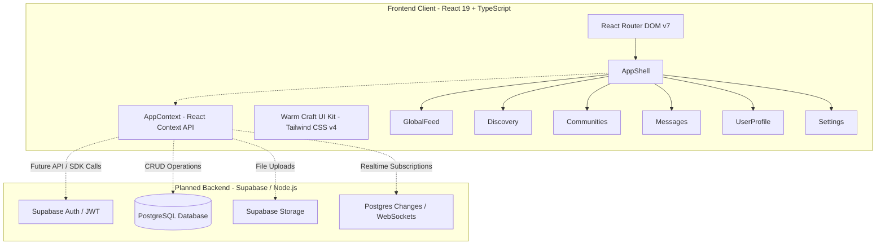

# Peer Networking & Collaboration Platform — Technical Documentation

Welcome to the official technical and architectural documentation for the **Peer Networking & Collaboration Platform**. This document provides an exhaustive overview of the platform's vision, design system, component hierarchy, data architecture, team integration workflows, and development setup.

---

## 1. Executive Summary & Project Overview

### 1.1 Objective
The **Peer Networking Platform** is a community-driven web application tailored for builders, developers, designers, and founders. It combines social discovery with real-time collaboration, topic-driven communities, and direct messaging, designed with a human-centric, artisan-inspired aesthetic ("Warm Craft").

### 1.2 Core Pillars
1. **Curated Feed & Discovery**: Chronological and algorithmic feeds spotlighting what peers are currently building, writing, and launching.
2. **Community Spaces**: Micro-hubs with specialized channel discussions, resource sharing, and member directories.
3. **Builder Directory & Networking**: Seamless peer discovery by tech stack, project domain, and collaboration status.
4. **Direct Messaging**: Focused 1-on-1 and group thread communications for project partnerships.

---

## 2. Architecture & Tech Stack



### 2.1 Technology Matrix
- **Runtime & Bundler**: Vite 6+ with Hot Module Replacement (HMR).
- **Core Library**: React 19 + TypeScript.
- **Styling Engine**: Tailwind CSS v4 with custom `@theme` tokens and Lucide React icons.
- **Typography**: Google Fonts — *Fraunces* (Soft serif headings) and *DM Sans* (Clean, legible geometric body).
- **Client Routing**: `react-router-dom` v7 with path-based dynamic routes.
- **Backend / Database Integration Target**: Supabase (PostgreSQL, Row-Level Security, Auth, Storage).

---

## 3. "Warm Craft" Design System

The application departs from standard stark corporate blues in favor of an inviting, tactile editorial aesthetic.

### 3.1 Color Palette
| Token | Variable | Hex / Value | Description |
|---|---|---|---|
| **Background** | `--color-background` | `#FBF9F5` | Off-white, paper-like warm canvas |
| **Surface** | `--color-surface` | `#FFFFFF` | Card & modal background |
| **Primary** | `--color-primary` | `#1A1A1A` | Deep charcoal for high-contrast typography |
| **Muted** | `--color-muted` | `#6B635B` | Warm gray-brown for secondary text |
| **Border** | `--color-border` | `#E8E2D9` | Subtle stone-tinted dividers and outlines |
| **Terracotta** | `--color-terracotta` | `#C85A32` | Accent tone for calls to action, badges, and alerts |
| **Sage** | `--color-sage` | `#4A6B5D` | Calming organic green for tags and active indicators |
| **Cream** | `--color-cream` | `#F0EAE1` | Pill, button hover, and badge surfaces |

### 3.2 Typography Tokens
- **Display / Headers**: `font-serif` (`Fraunces, serif`) — used for page titles, hero headers, card headlines, and modal banners.
- **Interface / Body**: `font-sans` (`DM Sans, sans-serif`) — used for metadata, navigation items, buttons, and inputs.

---

## 4. Frontend Component Directory & Route Hierarchy

```
src/
├── App.tsx                     # Main Router and Page routes configuration
├── index.css                   # Global styles, fonts, and Tailwind v4 @theme tokens
├── context/
│   └── AppContext.tsx          # Global reactive state provider and dispatch actions
├── lib/
│   ├── types.ts                # TypeScript domain models and interfaces
│   └── mock-data.ts            # Realistic fixture data for seed state
└── components/
    ├── layout/
    │   ├── AppShell.tsx        # 3-column responsive layout (Nav, Main, Discovery)
    │   └── LandingLayout.tsx   # Public marketing/login landing view
    ├── feed/
    │   ├── GlobalFeed.tsx      # Main timeline with sorting tabs and updates
    │   ├── PostComposer.tsx    # Rich creation modal with media and tag selection
    │   ├── PostCard.tsx        # Interactive feed item (likes, comments, share, save)
    │   └── CommunitySpace.tsx  # Dedicated space page with channel switcher
    ├── discovery/
    │   └── Discovery.tsx       # Search, filter chips, and member connect cards
    ├── communities/
    │   └── MyCommunities.tsx   # Grid of joined & discoverable hubs
    ├── messages/
    │   └── Messages.tsx        # Responsive chat drawer, thread list, and message box
    ├── profile/
    │   └── UserProfile.tsx     # Profile header, stats, building tags, and edit modal
    ├── settings/
    │   └── Settings.tsx        # Profile preferences, notifications, and security
    └── ui/
        ├── button.tsx          # Button variants (primary, secondary, outline, ghost)
        └── primitives.tsx      # Card, Badge, Input, Textarea, Avatar atomic components
```

### 4.1 Route Map
| Route Path | Component | Description |
|---|---|---|
| `/` | `LandingLayout` | Welcome splash view with guest entry and feature highlights |
| `/feed` | `GlobalFeed` (in `AppShell`) | Main interactive feed with post composer and community updates |
| `/discover` | `Discovery` (in `AppShell`) | Search and filter peers by craft, tags, and availability |
| `/communities` | `MyCommunities` (in `AppShell`) | Hub for exploring and managing community memberships |
| `/communities/:id` | `CommunitySpace` (in `AppShell`) | Detailed view of a single community and its channels |
| `/messages` | `Messages` (in `AppShell`) | Direct messaging inbox and active conversation thread |
| `/profile` | `UserProfile` (in `AppShell`) | Detailed user profile, builder portfolio, and history |
| `/settings` | `Settings` (in `AppShell`) | Account settings and personal preferences |

---

## 5. Domain Data Models (`src/lib/types.ts`)

### 5.1 Core Types
```typescript
export interface User {
  id: string;
  name: string;
  handle: string;
  title?: string;
  avatar: string;
  banner?: string;
  bio: string;
  location?: string;
  website?: string;
  building?: string[];
  skills?: string[];
  followersCount: number;
  followingCount: number;
  isConnected?: boolean;
}

export interface Post {
  id: string;
  author: User;
  content: string;
  media?: string[];
  tags: string[];
  communityId?: string;
  communityName?: string;
  likes: number;
  comments: Comment[];
  shares: number;
  isLiked?: boolean;
  isSaved?: boolean;
  createdAt: string;
}

export interface Community {
  id: string;
  name: string;
  slug: string;
  description: string;
  avatar: string;
  banner: string;
  membersCount: number;
  tags: string[];
  isJoined?: boolean;
  channels: { id: string; name: string }[];
}

export interface Message {
  id: string;
  senderId: string;
  receiverId: string;
  content: string;
  createdAt: string;
}

export interface Conversation {
  id: string;
  participant: User;
  lastMessage?: string;
  updatedAt: string;
  unreadCount?: number;
}
```

---

## 6. Team Collaboration & Backend Integration Guide

This repository is divided across functional team branches:
- `frontend-and-ui`: Client-side architecture, styling, and interactivity.
- `core-features`: Business logic, complex workflows, notifications, and search indexing.
- `backend-team`: Database schema, Supabase authentication, storage buckets, and REST/GraphQL APIs.

### 6.1 Backend Team Hand-off Checklist
1. **Supabase Initialization**:
   - Install `@supabase/supabase-js`.
   - Configure environment variables in `.env`:
     ```env
     VITE_SUPABASE_URL=https://your-project.supabase.co
     VITE_SUPABASE_ANON_KEY=your-anon-key
     ```
2. **Schema Mapping**:
   - `users` table: maps directly to `User` interface (`id`, `raw_user_meta_data`, `bio`, `building`, `skills`).
   - `posts` table: foreign keys to `users.id` and optional `communities.id`.
   - `community_members`: join table for `user_id` and `community_id`.
   - `messages`: real-time table subscribed to via Supabase channel filters.
3. **State Transition**:
   - Replace mock seed functions in `AppContext.tsx` with asynchronous Supabase client queries.

---

## 7. Development & Build Setup

### Prerequisites
- Node.js 18.x or 20.x
- npm or pnpm

### Getting Started
```bash
# 1. Clone repository
git clone https://github.com/Bhuvaneshdarkfire/networking-Platform.git
cd networking-Platform

# 2. Check out working branch
git checkout frontend-and-ui

# 3. Install dependencies
npm install

# 4. Run Vite development server
npm run dev

# 5. Type-check and production build
npx tsc --noEmit
npm run build
```
